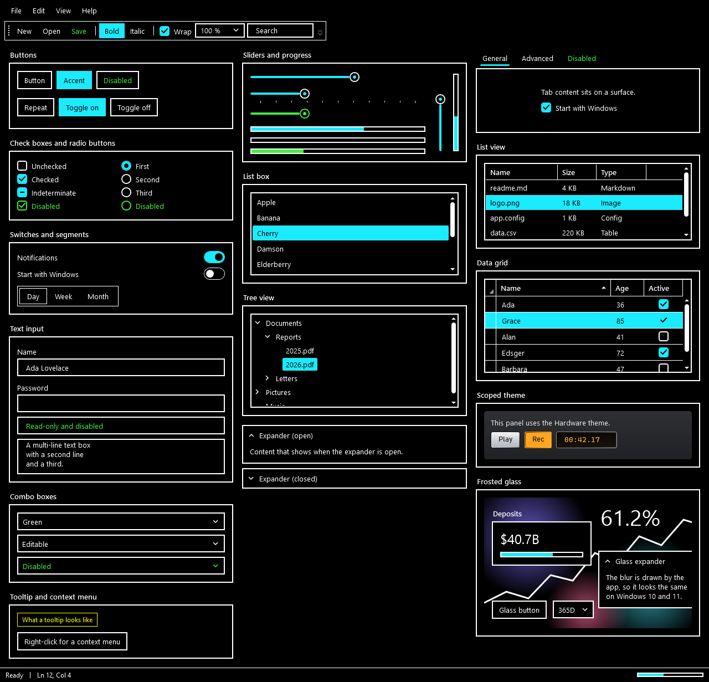
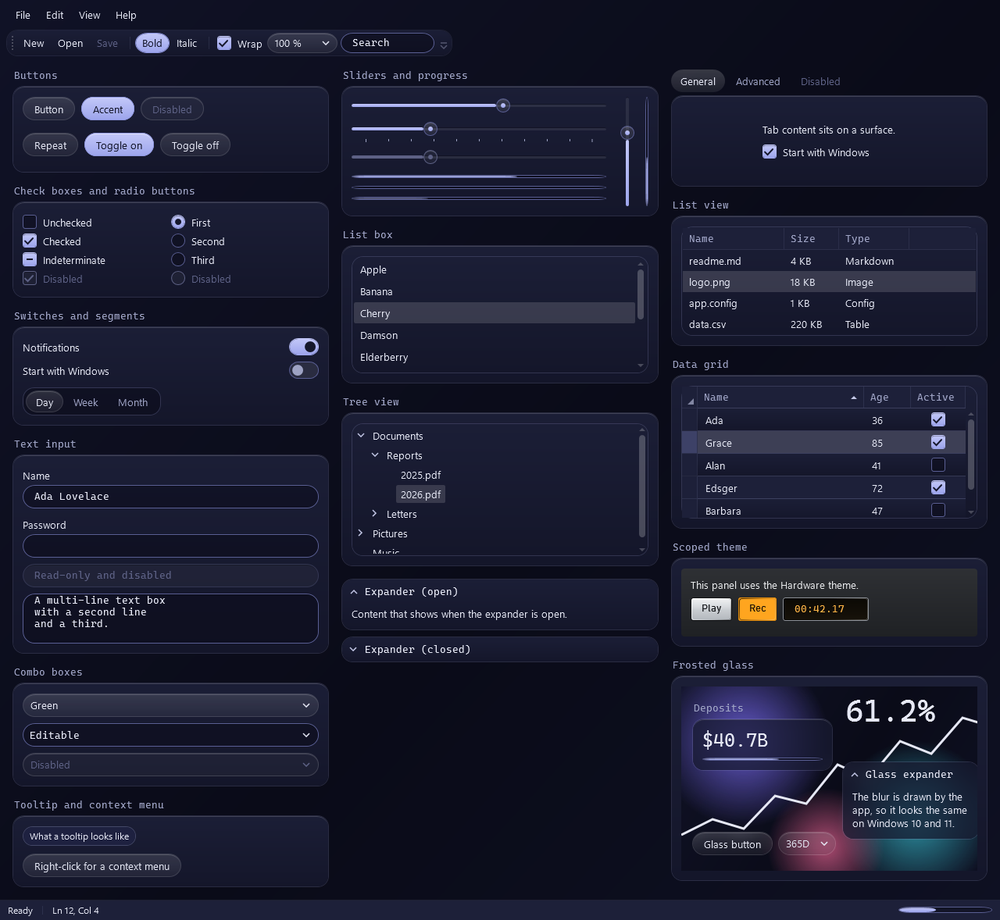
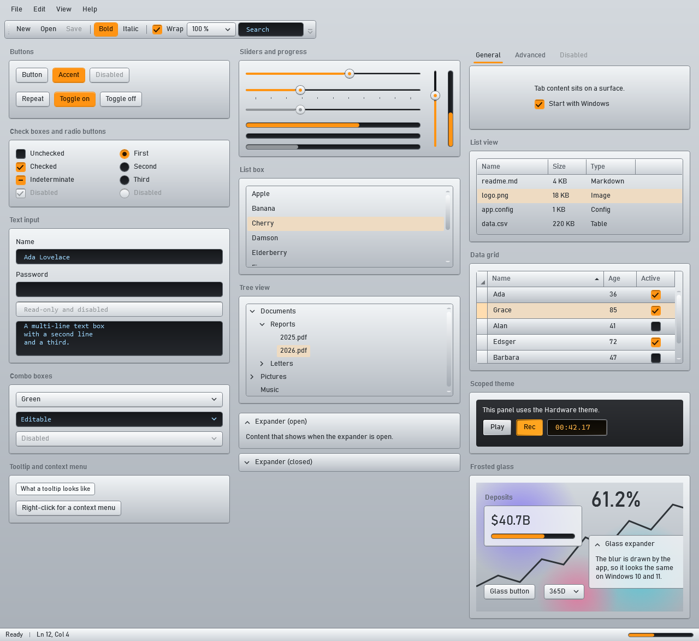
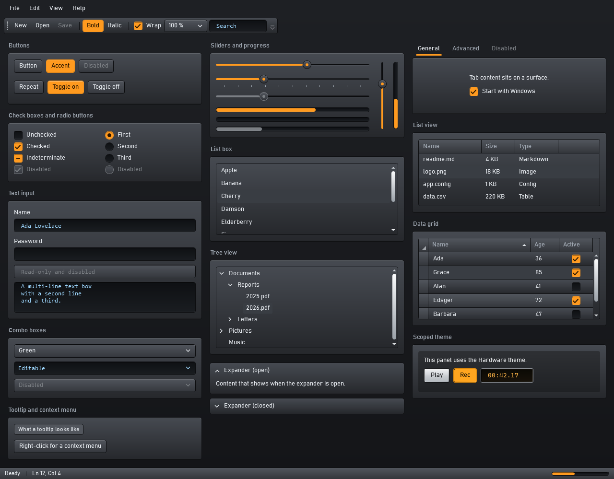
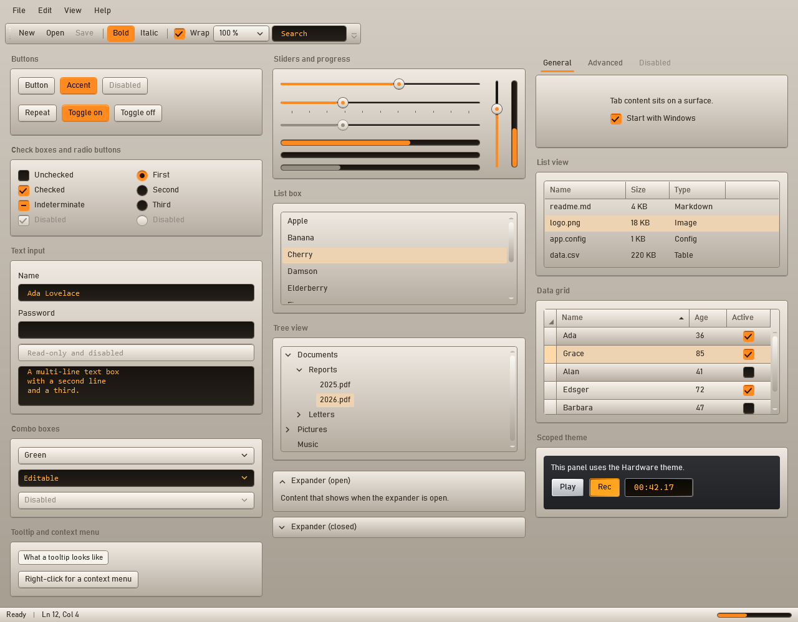
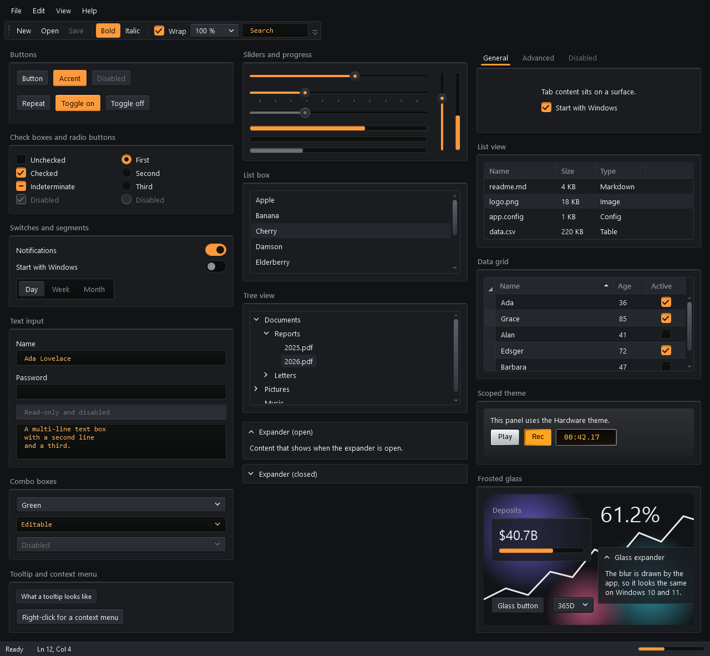
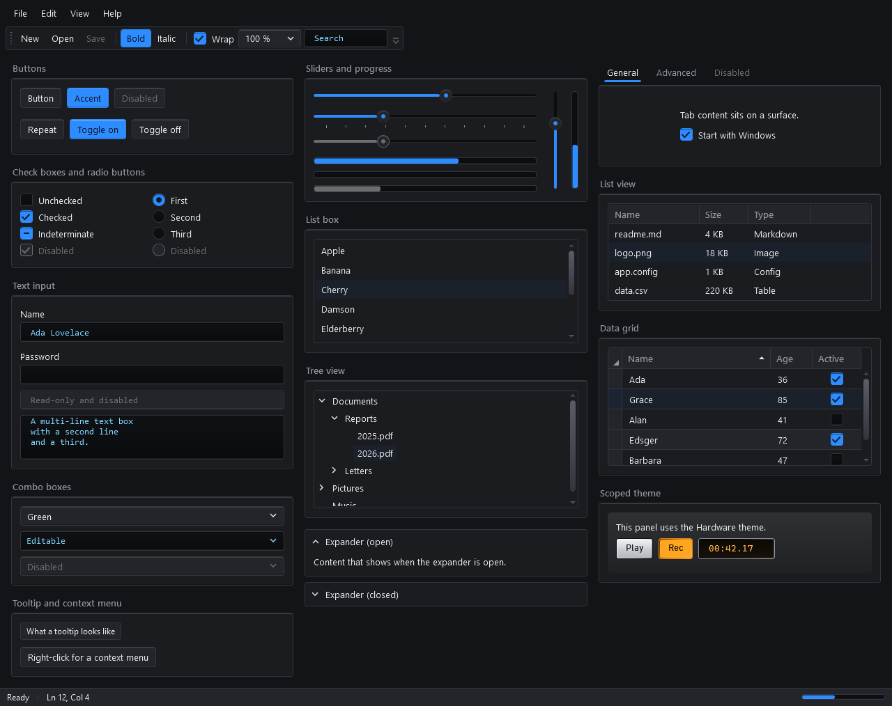
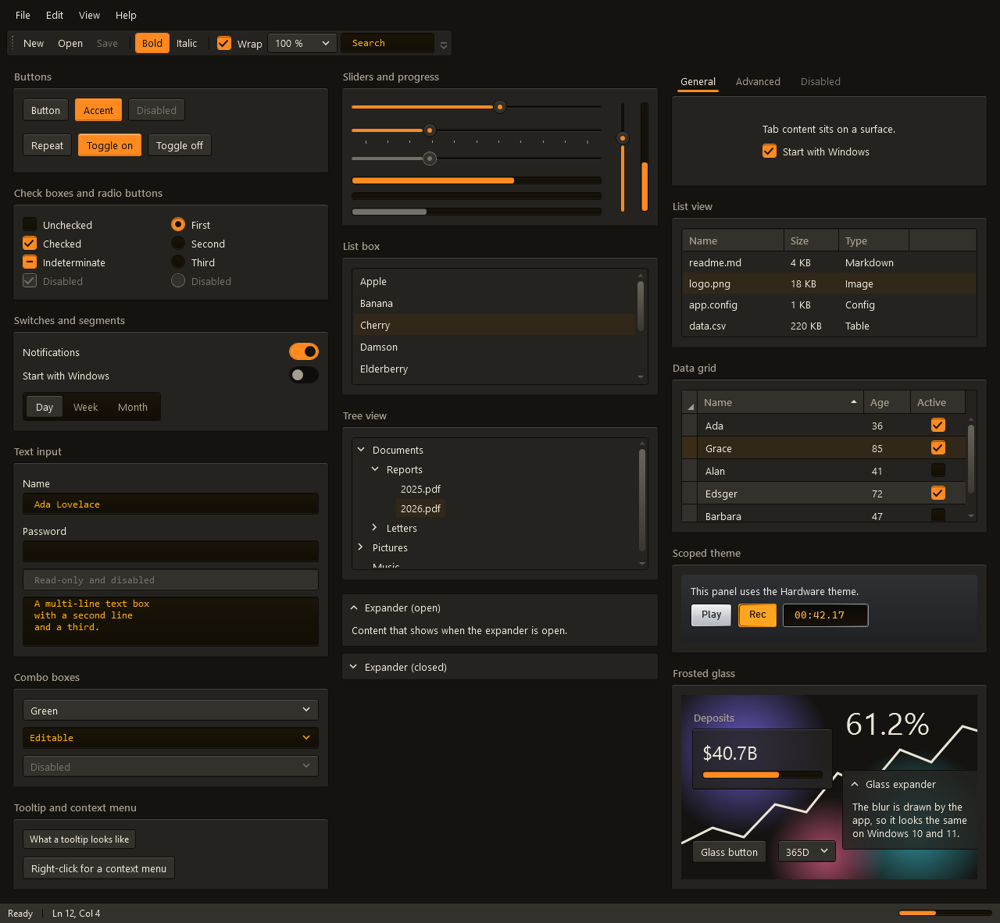
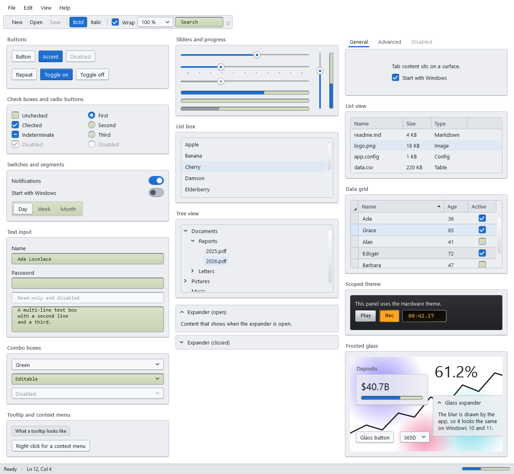
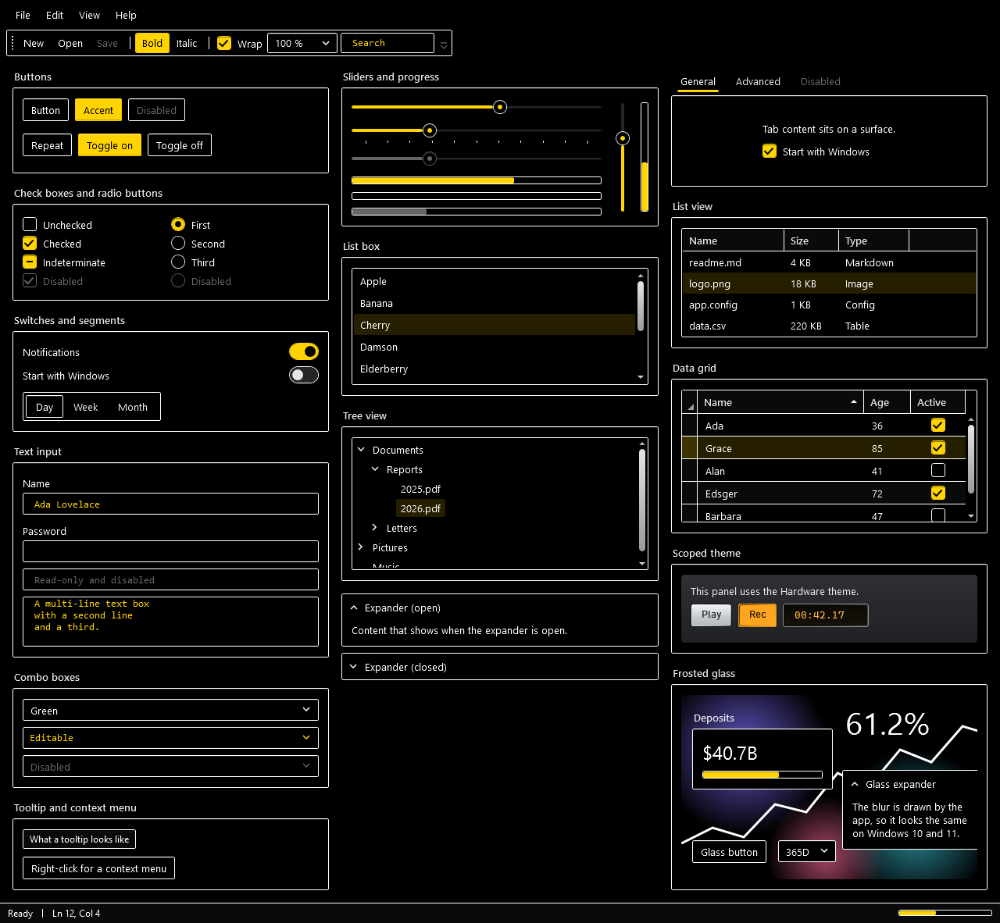

# NWpfThemes

[](https://github.com/duskozi/nWpfThemes/actions/workflows/ci.yml)
[](https://www.nuget.org/packages/NWpfThemes)

Themes for the standard WPF controls. Add the package, add one line to `App.xaml`, and every
Button, TextBox, DataGrid, Menu and the rest of the built-in controls pick up the theme.

- Thirteen themes in the box: **Dark**, **Light**, **High Contrast**, **Hardware** and **Midnight Glass**,
  plus eight that match the skins of [nDAWControls](https://github.com/duskozi/nDAWControls): **Alloy**,
  **Alloy Night**, **Alloy Ember**, **Graphite**, **Studio**, **Retro Hardware**, **Light Classic** and
  **High Contrast Black**.
- Themes switch live while the app runs, for the whole app or for one part of a window.
- Every theme is one `ResourceDictionary` filling the same public keys, so a custom theme is a copy of
  one file with new values.
- Visible keyboard focus, WCAG AA contrast, and automatic use of the Windows high contrast colours.
- No dependencies beyond WPF. Targets .NET 8 and .NET 10.

## Screenshots

These are rendered by CI from the gallery app on every push to `main`.

| Dark | Light |
| --- | --- |
|  |  |
| **High Contrast** (shown with a dark high contrast palette) | **Hardware** |
|  |  |

### Midnight Glass

A dark dashboard look: deep indigo backgrounds with a soft gradient, frosted glass panels with thin
light edges and large rounded corners, pill-shaped buttons, inputs and tabs, muted lavender accents,
monospaced headers and slim progress bars.



### nDAWControls skins

These use the same colours, gradients and button bevels as the nDAWControls skins, so standard
controls sit next to the DAW controls without a seam. Text boxes look like the skin's recessed displays.

| | |
| --- | --- |
| **Alloy** | **Alloy Night** |
|  |  |
| **Alloy Ember** | **Graphite** |
|  |  |
| **Studio** | **Retro Hardware** |
|  |  |
| **Light Classic** | **High Contrast Black** |
|  |  |

## Install

```
dotnet add package NWpfThemes
```

## Set up

Replace the resources in `App.xaml` with one line:

```xml
<Application x:Class="MyApp.App"
             xmlns="http://schemas.microsoft.com/winfx/2006/xaml/presentation"
             xmlns:x="http://schemas.microsoft.com/winfx/2006/xaml"
             xmlns:nwt="https://github.com/duskozi/nWpfThemes"
             StartupUri="MainWindow.xaml">
    <Application.Resources>
        <nwt:ThemeResources Theme="Dark" />
    </Application.Resources>
</Application>
```

`ThemeResources` merges the control styles and the theme you name. If you already have application
resources, merge it next to them:

```xml
<Application.Resources>
    <ResourceDictionary>
        <ResourceDictionary.MergedDictionaries>
            <nwt:ThemeResources Theme="Dark" />
            <ResourceDictionary Source="MyStyles.xaml" />
        </ResourceDictionary.MergedDictionaries>
    </ResourceDictionary>
</Application.Resources>
```

Or merge the two dictionaries yourself:

```xml
<ResourceDictionary Source="/NWpfThemes;component/Themes/Dark.xaml" />
<ResourceDictionary Source="/NWpfThemes;component/Styles/Controls.xaml" />
```

### Windows

Standard controls are styled automatically. A window needs one more step, because WPF does not apply
implicit styles to your `Window` subclasses. Either:

- derive from `ThemedWindow` to get a themed title bar and frame, or
- keep `Window` and set `Style="{DynamicResource NwtWindowStyle}"` for the theme background, text
  colour and font.

```xml
<nwt:ThemedWindow x:Class="MyApp.MainWindow"
                  xmlns="http://schemas.microsoft.com/winfx/2006/xaml/presentation"
                  xmlns:x="http://schemas.microsoft.com/winfx/2006/xaml"
                  xmlns:nwt="https://github.com/duskozi/nWpfThemes"
                  Title="My app">
    ...
</nwt:ThemedWindow>
```

```csharp
public partial class MainWindow : NWpfThemes.ThemedWindow { ... }
```

`ThemedWindow.TitleBarContent` puts your own controls in the title bar, next to the caption buttons.

## Switch themes

```csharp
using NWpfThemes;

ThemeManager.ApplyTheme(Theme.Light);          // the whole app
ThemeManager.ApplyTheme("Hardware");           // by name
ThemeManager.ApplyTheme(sidePanel, Theme.Dark); // one element and everything inside it
ThemeManager.ClearTheme(sidePanel);            // inherit again
```

In XAML, theme part of a window with the attached property:

```xml
<Border nwt:ThemeManager.Theme="Hardware"> ... </Border>
```

`ThemeManager.Themes` lists the available themes, `ThemeManager.CurrentTheme` is the app theme, and
`ThemeManager.ThemeChanged` fires after every change.

## Extra styles

| Key | Use |
| --- | --- |
| `NwtAccentButtonStyle` | A button filled with the accent colour. Buttons with `IsDefault="True"` look the same. |
| `NwtWindowStyle` | Theme background, text colour and font for a plain `Window`. |
| `NwtFocusVisualStyle` | The keyboard focus ring, for your own controls. |
| `NwtDataGridCheckBoxStyle`, `NwtDataGridEditingCheckBoxStyle` | `ElementStyle` and `EditingElementStyle` for a `DataGridCheckBoxColumn`, whose check boxes otherwise keep the Windows look. |

## Frosted glass

Group boxes, expanders and tab pages can show a blurred copy of what is behind them. Point
`nwt:Glass.Backdrop` at the element that draws the background art, on a container of the panels:

```xml
<Grid>
    <Image x:Name="Art" Source="wallpaper.jpg" Stretch="UniformToFill" />
    <StackPanel nwt:Glass.Backdrop="{Binding ElementName=Art}" nwt:Glass.BlurRadius="24">
        <GroupBox Header="Frosted">...</GroupBox>
    </StackPanel>
</Grid>
```

- The blur is drawn by the library, not by Windows, so it looks the same on Windows 10 and 11 and in
  any window, with no flicker or lag while the window moves.
- It is fast: the backdrop is rendered once at a quarter of its size, blurred, and shared by every panel
  over it. Moving or scrolling a panel only shows a different part of that image. The image is rebuilt
  when the backdrop changes size or the theme changes; call `Glass.Refresh(backdrop)` if it changes
  in other ways, such as an animation.
- The backdrop must sit behind the panels, not contain them.
- The tint over the blur is `NwtGlassTintBrush`. Midnight Glass lets the most show through; the high
  contrast themes use an opaque tint, so they never show a blur. Without a backdrop, panels look as usual.
- In your own templates, add a `nwt:GlassBackdropLayer` under the content.

## High contrast and accessibility

- When Windows high contrast is on, `ThemeManager` uses the **High Contrast** theme everywhere and
  switches back when it is turned off. Set `ThemeManager.FollowSystemHighContrast = false` to opt out.
  This works when the theme was set with `ThemeResources` or `ThemeManager`.
- The High Contrast theme reads every colour from the Windows system colours, so it follows the
  palette the user picked.
- Every focusable control shows a keyboard focus indicator: a ring for buttons and toggles, an accent
  border for text inputs, and a dotted outline for items in lists, grids and menus.
- The Dark, Light and Hardware palettes meet WCAG 2.1 AA: 4.5:1 for text and 3:1 for focus rings,
  input borders and indicators. A unit test checks every pair.
- The nDAWControls skin themes keep the skins' own colours. Text on every surface, control face,
  display and accent fill, and the focus ring, meet the same ratios; dim labels, display outlines and
  the accent on bare metal are as dim as in the skins. In Alloy and Alloy Ember the focus ring is a
  darker orange than the skin's, so it stays visible on silver.

## Make your own theme

1. Copy one theme file from [`src/NWpfThemes/Themes`](src/NWpfThemes/Themes) into your app, for
   example `Themes/Ocean.xaml`, with build action **Page** (the default for XAML files).
2. Change `NwtThemeName` and any other values. Brushes can be solid colours or gradients.
3. Register and apply it:

```csharp
var ocean = new Theme("Ocean", new Uri("/MyApp;component/Themes/Ocean.xaml", UriKind.Relative));
ThemeManager.Register(ocean);
ThemeManager.ApplyTheme(ocean);
```

Or start with it in `App.xaml` by merging it instead of a built-in theme:

```xml
<ResourceDictionary Source="Themes/Ocean.xaml" />
<ResourceDictionary Source="/NWpfThemes;component/Styles/Controls.xaml" />
```

You can also use the keys in your own XAML, for example
`Background="{DynamicResource NwtSurfaceBrush}"`, and in code through the `ThemeKeys` constants.

### Resource keys

Every theme defines all of these keys.

| Key | Type | Used for |
| --- | --- | --- |
| `NwtThemeName` | String | The display name of the theme. Every theme dictionary defines it; ThemeManager uses it to find the active theme. |
| `NwtFontFamily` | FontFamily | The font used for text in controls. |
| `NwtInputFontFamily` | FontFamily | The font used inside text inputs and displays. |
| `NwtHeaderFontFamily` | FontFamily | The font of group box titles, expander headers and column headers. |
| `NwtHeaderFontWeight` | FontWeight | The weight of group box titles and column headers. |
| `NwtFontSize` | Double | The normal font size. |
| `NwtFontSizeSmall` | Double | A smaller font size for secondary text. |
| `NwtFontSizeLarge` | Double | A larger font size for headers. |
| `NwtControlCornerRadius` | CornerRadius | The corner radius of buttons, inputs and other controls. |
| `NwtOverlayCornerRadius` | CornerRadius | The corner radius of menus, popups and tooltips. |
| `NwtPanelCornerRadius` | CornerRadius | The corner radius of panels: group boxes, expanders, lists, trees, data grids, tab pages and toolbars. |
| `NwtControlBorderThickness` | Thickness | The border thickness of controls. |
| `NwtControlPadding` | Thickness | The inner padding of buttons and inputs. |
| `NwtControlMinHeight` | Double | The minimum height of buttons, inputs and combo boxes. |
| `NwtProgressBarThickness` | Double | The height of horizontal progress bars (the width of vertical ones). |
| `NwtFocusStrokeThickness` | Double | The stroke thickness of the keyboard focus indicator. |
| `NwtFocusCornerRadius` | Double | The corner radius of the keyboard focus ring drawn around buttons and other controls. |
| `NwtBackgroundColor` | Color | The window background colour. |
| `NwtSurfaceColor` | Color | The colour of panels, menus and popups. |
| `NwtForegroundColor` | Color | The main text colour. |
| `NwtAccentColor` | Color | The accent colour. |
| `NwtBorderColor` | Color | The border colour. |
| `NwtShadowColor` | Color | The colour of drop shadows under popups. |
| `NwtBackgroundBrush` | Brush | The window background. |
| `NwtSurfaceBrush` | Brush | The background of panels, lists, menus and popups. |
| `NwtSurfaceAltBrush` | Brush | An alternative surface for headers, status bars and alternating rows. |
| `NwtForegroundBrush` | Brush | The main text colour on backgrounds and surfaces. |
| `NwtForegroundSecondaryBrush` | Brush | Secondary text, such as headers and hints. |
| `NwtForegroundDisabledBrush` | Brush | Text of disabled controls. |
| `NwtBorderBrush` | Brush | The border of controls and panels. |
| `NwtBorderHoverBrush` | Brush | The border of a control under the mouse. |
| `NwtSeparatorBrush` | Brush | Separator lines and grid lines. |
| `NwtControlBackgroundBrush` | Brush | The face of buttons and other clickable controls. |
| `NwtControlHoverBrush` | Brush | The face of a clickable control under the mouse. |
| `NwtControlPressedBrush` | Brush | The face of a pressed control. |
| `NwtControlDisabledBrush` | Brush | The face of a disabled control. |
| `NwtControlForegroundBrush` | Brush | Text on control faces. |
| `NwtControlHoverForegroundBrush` | Brush | Text on a control face that is under the mouse or pressed. |
| `NwtControlBorderBrush` | Brush | The outline of buttons, combo boxes and other control faces. |
| `NwtControlBevelBrush` | Brush | An inner edge that makes controls look raised. Transparent in flat themes. |
| `NwtControlPressedBevelBrush` | Brush | The inner edge of a control face while it is pressed. |
| `NwtControlCheckedBevelBrush` | Brush | The inner edge of a checked toggle button, which is filled with the accent colour. |
| `NwtControlBevelThickness` | Thickness | How wide the control bevel is on each side, for example `0,1,0,1` for a top light and bottom shade only. |
| `NwtInputBackgroundBrush` | Brush | The background of text inputs, progress tracks and other displays. |
| `NwtInputForegroundBrush` | Brush | Text inside inputs and displays. |
| `NwtInputBorderBrush` | Brush | The border of inputs. |
| `NwtInputBevelBrush` | Brush | An inner edge that makes inputs look recessed. Transparent in flat themes. |
| `NwtInputBevelThickness` | Thickness | How wide the input bevel is on each side. |
| `NwtAccentBrush` | Brush | The accent: checked states, default buttons, progress and slider fill. |
| `NwtAccentHoverBrush` | Brush | The accent under the mouse. |
| `NwtAccentPressedBrush` | Brush | The accent when pressed. |
| `NwtAccentForegroundBrush` | Brush | Text and glyphs on the accent. |
| `NwtSelectionBrush` | Brush | The background of selected items. |
| `NwtSelectionForegroundBrush` | Brush | Text of selected items. |
| `NwtSelectionInactiveBrush` | Brush | The background of selected items when their control does not have focus. |
| `NwtSelectionInactiveForegroundBrush` | Brush | Text of selected items when their control does not have focus. |
| `NwtHoverBrush` | Brush | The background of list and menu items under the mouse. |
| `NwtHoverForegroundBrush` | Brush | Text of list and menu items under the mouse. |
| `NwtFocusBrush` | Brush | The keyboard focus indicator. |
| `NwtGlyphBrush` | Brush | Arrows, chevrons and other glyphs. |
| `NwtTrackBrush` | Brush | The track of sliders and scroll bars. |
| `NwtThumbBrush` | Brush | Scroll bar thumbs. |
| `NwtThumbHoverBrush` | Brush | A scroll bar thumb under the mouse. |
| `NwtThumbPressedBrush` | Brush | A scroll bar thumb being dragged. |
| `NwtTabSelectedBrush` | Brush | The background of the selected tab. Transparent when tabs are marked by the indicator only. |
| `NwtTabIndicatorBrush` | Brush | The bar that marks the selected tab. Transparent when the selected tab is marked by its background only. |
| `NwtGlassTintBrush` | Brush | The translucent fill over the blurred backdrop of glass panels (see Glass). |
| `NwtToolTipBackgroundBrush` | Brush | The tooltip background. |
| `NwtToolTipForegroundBrush` | Brush | The tooltip text. |
| `NwtToolTipBorderBrush` | Brush | The tooltip border. |
| `NwtTitleBarBackgroundBrush` | Brush | The title bar of an active ThemedWindow. |
| `NwtTitleBarForegroundBrush` | Brush | The title text of an active ThemedWindow. |
| `NwtTitleBarInactiveBackgroundBrush` | Brush | The title bar of an inactive ThemedWindow. |
| `NwtTitleBarInactiveForegroundBrush` | Brush | The title text of an inactive ThemedWindow. |
| `NwtCaptionButtonHoverBrush` | Brush | The minimize, maximize and restore buttons under the mouse. |
| `NwtCaptionButtonHoverForegroundBrush` | Brush | The glyphs of caption buttons under the mouse. |
| `NwtCloseButtonHoverBrush` | Brush | The close button under the mouse. |
| `NwtCloseButtonHoverForegroundBrush` | Brush | The close glyph under the mouse. |
| `NwtErrorBrush` | Brush | Validation errors. |

## Styled controls

Window chrome (`ThemedWindow`), Button, RepeatButton, ToggleButton, CheckBox, RadioButton, TextBox,
PasswordBox, ComboBox, Slider, ScrollBar, ScrollViewer, ListBox, ListView (including GridView),
TreeView, DataGrid, TabControl, Menu, ContextMenu, ToolTip, ProgressBar, GroupBox, Expander,
StatusBar, ToolBar, plus Label, Separator and ResizeGrip.

## Build and run the gallery

You need Windows and the .NET 10 SDK (the library also targets .NET 8).

```
dotnet build
dotnet test
dotnet run --project samples/NWpfThemes.Gallery
```

The gallery shows every control with a theme picker in the title bar. To render the screenshots:

```
samples/NWpfThemes.Gallery/bin/Debug/net10.0-windows/NWpfThemes.Gallery.exe --screenshots out
```

## Releasing

Pushing a tag such as `v1.0.0` or `v1.1.0-beta.1` runs the
[publish workflow](.github/workflows/publish.yml), which builds, tests and pushes that version to
NuGet with [Trusted Publishing](https://learn.microsoft.com/nuget/nuget-org/trusted-publishing), so no
API key is stored. One-time setup:

1. On nuget.org, open **Trusted Publishing** under your account and add a policy for repository owner
   `duskozi`, repository `nWpfThemes` and workflow file `publish.yml`.
2. In the GitHub repository, add a secret named `NUGET_USER` with your nuget.org user name
   (not your email address).

## License

[MIT](LICENSE)
